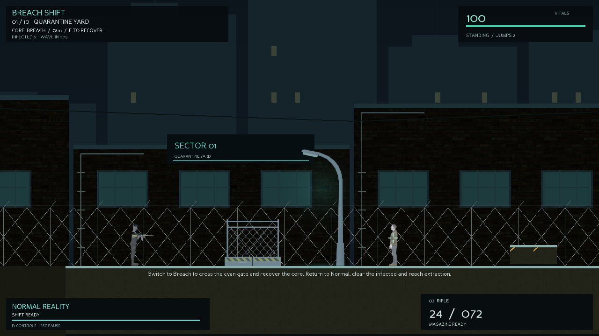
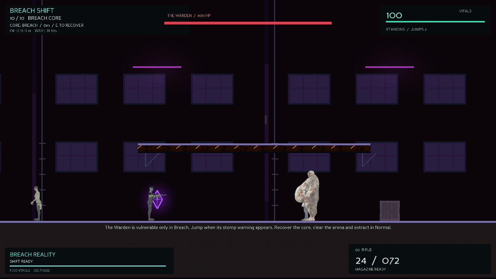

# Breach Shift

An offline **2D side-view zombie action game** built in Python with Panda3D.
Fight through ten platform maps, switch between **Normal** and **Breach**,
recover each core and reach extraction. Ten infected types culminate in the
supplied Warden boss, vulnerable only in Breach.

The game uses animated PNG sprites, layered city/interior scenery and four
weapons with independent ammunition. Movement includes double jumps, crouching,
ceiling collisions and one-way platforms. Reloads, attacks and deaths have
animated poses. There is no runtime 3D model loading or paid generation.

## Run

Requires Python 3.10 or newer. From the project directory:

```powershell
python -m venv .venv
.\.venv\Scripts\python.exe -m pip install -r requirements.txt
.\.venv\Scripts\python.exe main.py
```

With the existing environment, only the final command is needed. Practice on
the Warden sector or start the firing range:

```powershell
.\.venv\Scripts\python.exe main.py --level 10
.\.venv\Scripts\python.exe main.py --training
```

`python -m breach_shift` and the installed `breach-shift` command use the same
launcher. Map numbers range from 1 to 10; `--training` is a separate mode.

## Controls

| Input | Action |
| --- | --- |
| A / D or Left / Right | Move left / right |
| Mouse / Left click | Aim / shoot; hold for SMG and rifle |
| Space / W / Up | Jump; release and press again for a double jump |
| C / Ctrl / Down, held | Crouch and move slowly under low passages |
| R | Reload |
| 1 / 2 / 3 / 4 | Pistol / SMG / rifle / shotgun |
| Shift | Change reality; two-second cooldown |
| E | Recover a nearby core or use extraction |
| T | Retry the sector; restart the range or completed campaign |
| Esc | Pause / resume; the pause menu also provides Quit |
| F1 | Open / close controls and pause gameplay |
| M | Toggle sound |

Cross the cyan gate in Breach, recover the purple core with E, clear the
infected and return to Normal to cross the next gate and extract. Recovering
the core stops reinforcements and heals up to 25 HP. Each kill drops ammunition.
Jump when the Warden's stomp warning appears. Pausing or losing window focus
stops the simulation and releases held fire.

## Current game previews

These are captures of the actual renderer:




## Project

| Location | Purpose |
| --- | --- |
| [main.py](./main.py), [app](./breach_shift/app.py) | Shared launcher |
| [platformer](./breach_shift/platformer) | 2D physics, maps, simulation, renderer and input |
| [combat](./breach_shift/combat), [enemies](./breach_shift/enemies) | Arsenal, loot and infected specifications |
| [campaign](./breach_shift/campaign), [reality](./breach_shift/world/reality.py) | Progress, reinforcement timing and Shift |
| [player](./breach_shift/player), [training](./breach_shift/training) | Health and firing-range statistics |
| [game data](./breach_shift/data) | Ten maps, PNG art, sound effects and credits |
| [tests](./tests) | Pure gameplay and real-renderer regressions |
| [tools](./tools) | Offline art/audio rebuilding, previews and package validation |

## Verification and art

```powershell
.\.venv\Scripts\python.exe -m unittest discover -s tests -v
.\.venv\Scripts\python.exe -m compileall -q breach_shift tests tools
$env:PYTHONPATH='.'
.\.venv\Scripts\python.exe tools/preview.py
```

Tests cover collisions, both realities, every map, weapons, animation data,
mirrored rendering and pause/retry input. Manual keyboard/mouse play and
difficulty balancing remain useful alongside automated checks.

See [2D art and rebuilding](./docs/2d-art.md) and
[asset credits](./breach_shift/data/credits/sprites.md). The optional baker
reuses model data from local Git history, so obsolete 3D exports and Blender
bundles are unnecessary in the working tree. The user's original downloaded
sculpt is outside this project and is not modified.

Gameplay uses no network services, account login or API keys. No Fal.ai calls
were made for the 2D conversion.
